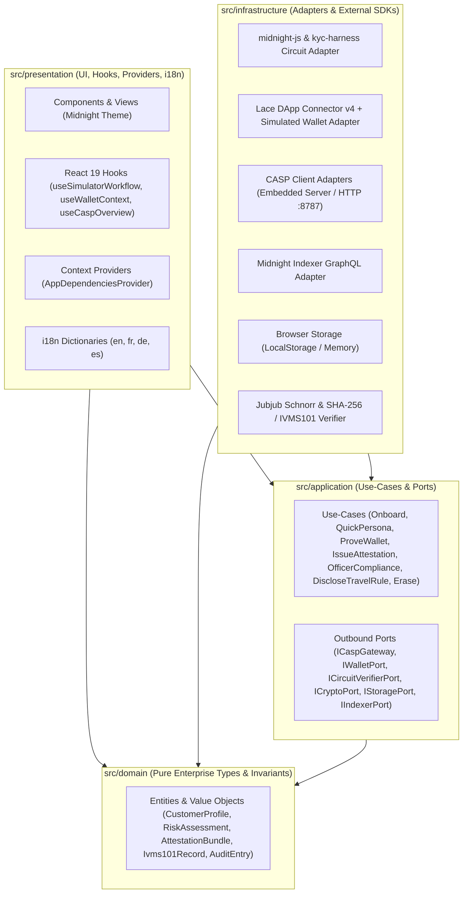

# EU Counterparty Simulator — Front-End Implementation Plan

> [!CAUTION]
> **TEST-ONLY / SYNTHETIC DATA ONLY.** Like the core [`eu-counterparty-simulator`](../README.md), this front-end is a test and simulation workbench for Midnight dApps. Every screen must display a persistent synthetic-data banner, and no real personal data or live sanctions feeds may be entered.

---

## 1. Architectural Overview & Clean Architecture Boundaries

The front-end application lives in a dedicated workspace package **`apps/web`** inside the repository, keeping the existing root library, Compact contracts ([`compact/KycAttestationV1.compact`](../compact/KycAttestationV1.compact) and [`compact/kyc-harness.compact`](../compact/kyc-harness.compact)), and CLI ([`src/cli.ts`](../src/cli.ts)) untouched.

Within `apps/web`, all source code under `src/` enforces **strict inward-pointing dependencies**:



### Dependency Rule Enforcement
1. **`src/domain`**: Zero external runtime dependencies. Pure TypeScript interfaces, types, value objects, and domain invariants (e.g., KYC levels `0..3`, risk score `0..255`, decision rules, 32-byte hex validation).
2. **`src/application`**: Depends **only** on `src/domain`. Defines **Port interfaces** (driven/outbound ports) and **Use-Cases** (interactors) that orchestrate domain workflows.
3. **`src/infrastructure`**: Implements the ports defined in `src/application`. Houses `@midnight-ntwrk/*` SDK packages, `@midnight-ntwrk/dapp-connector-api`, `#kyc-harness` circuit verifier, HTTP/Embedded CASP client adapters, storage, and cryptographic primitives.
4. **`src/presentation`**: Depends on `src/application` (use-cases & port types) and `src/domain`. Wires concrete `src/infrastructure` adapters in the root composition provider (`AppDependenciesProvider`). Next.js `src/app/` routes are thin shells that render `src/presentation` views and bind Next.js API Route Handlers to the embedded `CaspSimulator`.

---

## 2. Directory Structure (`apps/web`)

```text
eu-counterparty-simulator/
├── package.json                          # npm workspaces: ["apps/web"]
├── compact/                              # Canonical KycAttestationV1.compact & kyc-harness
├── src/                                  # Existing CASP core library & CLI (unchanged)
└── apps/
    └── web/
        ├── package.json                  # Next.js 15, React 19, Tailwind v4, Midnight SDK, Vitest
        ├── tsconfig.json                 # Strict TS + path aliases (@/domain, @/application, etc.)
        ├── next.config.ts                # WASM, top-level-await, alias resolution
        ├── vitest.config.ts              # Vitest + @testing-library/react + architectural boundary tests
        ├── postcss.config.mjs            # @tailwindcss/postcss
        └── src/
            ├── domain/                   # Layer 1: Pure Domain Types & Value Objects
            │   ├── index.ts
            │   ├── customer.ts           # Person, Address, CustomerProfile, CustomerRecord, CustomerStatus
            │   ├── compliance.ts         # Decision, RiskFactor, RiskAssessment, Policy, SanctionsEntry, Persona
            │   ├── attestation.ts        # WirePoint, WireSignature, WireAttestation, AttestationBundle, RevocationBundle
            │   ├── wallet.ts             # OwnershipMethod, WalletChallenge, OwnershipProof, ConnectedWalletInfo
            │   ├── travel-rule.ts        # TravelRuleRole, Ivms101Record, TravelRuleDisclosure
            │   ├── issuer.ts             # KeyStatus, IssuerKeySummary, AuditEntry, AuditVerificationResult
            │   └── errors.ts             # DomainError, CaspDomainErrorCode
            │
            ├── application/              # Layer 2: Use-Cases & Ports (Inward dependencies only)
            │   ├── index.ts
            │   ├── ports/
            │   │   ├── casp-gateway.port.ts        # ICaspGateway (customer, officer, notary, persona operations)
            │   │   ├── wallet.port.ts              # IWalletPort (connect Lace / Simulated wallet, get keys)
            │   │   ├── circuit-verifier.port.ts    # ICircuitVerifierPort & ICryptoPort
            │   │   └── storage.port.ts             # IStoragePort & IIndexerPort
            │   └── use-cases/
            │       ├── onboard-customer.use-case.ts
            │       ├── quick-onboard-persona.use-case.ts
            │       ├── issue-attestation.use-case.ts
            │       └── officer-compliance.use-case.ts
            │
            ├── infrastructure/           # Layer 3: Adapters (midnight-js, wallet, indexer, storage, crypto, tooling)
            │   ├── index.ts
            │   ├── midnight-js/
            │   │   └── kyc-harness.adapter.ts      # Wraps #kyc-harness Contract & compact-runtime for in-browser ZK circuit check
            │   ├── wallet/
            │   │   └── midnight-wallet.adapter.ts  # DApp Connector v4 (window.midnight) + Simulated Test Wallet
            │   ├── indexer/
            │   │   └── midnight-indexer.adapter.ts # GraphQL HTTP health & block height check
            │   ├── storage/
            │   │   └── browser-storage.adapter.ts  # localStorage & in-memory implementations of IStoragePort
            │   ├── crypto/
            │   │   └── casp-crypto.adapter.ts      # Implements ICryptoPort (SHA-256 IVMS101 commitment & witness export)
            │   └── tooling/
            │       ├── http-casp-gateway.adapter.ts      # Connects to standalone `casp-sim serve` (:8787) or `/api`
            │       └── embedded-casp-singleton.server.ts # Server-only singleton wrapping CaspSimulator for Next.js Route Handlers
            │
            ├── presentation/             # Layer 4: UI, Hooks, Providers, i18n
            │   ├── i18n/
            │   │   └── config.ts                   # Supported locales: 'en' | 'fr' | 'de' | 'es'
            │   ├── providers/
            │   │   └── dependency-injection.provider.tsx # Composition Root instantiating Infrastructure adapters & Use-Cases
            │   ├── hooks/
            │   │   └── use-simulator-workflow.ts   # Custom React 19 hooks driving use-cases
            │   ├── styles/
            │   │   └── midnight-theme.css          # Tailwind v4 Midnight obsidian & indigo/violet theme
            │   └── components/
            │       ├── CaspSimulatorWorkbench.tsx  # Main tabbed workbench
            │       ├── layout/
            │       │   └── TopHeaderBar.tsx        # Synthetic data warning, Clock controls, Backend/Locale/Wallet bar
            │       ├── onboarding/
            │       │   └── OnboardingWorkspace.tsx # Persona gallery, Custom CDD/EDD form, Risk gauge, GDPR erasure
            │       ├── attestation/
            │       │   └── AttestationWorkspace.tsx # Wallet ownership challenge, KycAttestationV1 issuer, In-circuit badge & Witness export
            │       └── compliance-console/
            │           └── ComplianceConsoleWorkspace.tsx # Officer EDD review, Key rotation/revocation, Travel Rule IVMS101 & Audit chain
            │
            └── app/                      # Next.js 15 App Router (Thin routing & API adapter layer)
                ├── layout.tsx
                ├── page.tsx
                └── api/                  # Zero-config Embedded CASP endpoints (mirrors src/api/server.ts)
                    ├── health/route.ts
                    ├── .well-known/casp-keys/route.ts
                    ├── personas/route.ts
                    ├── customers/route.ts
                    ├── customers/[id]/route.ts
                    ├── customers/[id]/wallet-challenge/route.ts
                    ├── customers/[id]/wallet-proof/route.ts
                    ├── customers/[id]/attestations/route.ts
                    ├── customers/[id]/erasure/route.ts
                    ├── test/personas/[name]/attestation/route.ts
                    ├── test/clock/route.ts
                    ├── attestations/[ref]/route.ts
                    ├── attestations/[ref]/revoke/route.ts
                    ├── issuer/keys/rotate/route.ts
                    ├── issuer/keys/[issuerId]/revoke/route.ts
                    ├── travel-rule/[ref]/route.ts
                    ├── audit/route.ts
                    └── audit/verify/route.ts
```

---

## 3. Layer-by-Layer Specifications

### 3.1 `src/domain` (Pure Domain Layer)
- **Customer & Compliance Models**:
  - Mirrors `Person`, `Address`, `CustomerProfile`, `Decision` (`'approve' | 'refer' | 'reject'`), `RiskFactor`, `RiskAssessment`, `Policy`, `SanctionsEntry`, and `Persona`.
  - Value object helpers: `isValidHex32(hex: string): boolean`, `formatKycLevel(level: number): 'L0' | 'L1' | 'L2' | 'L3'`, `canIssueAttestation(assessment: RiskAssessment, walletVerified: boolean): boolean`.
- **Attestation & Revocation Models**:
  - `WirePoint`, `WireSignature`, `WireAttestation`, `AttestationBundle`, `RevocationBundle`, and `CircuitVerificationSummary`.
- **Travel Rule & Audit Models**:
  - `Ivms101Record`, `TravelRuleDisclosure`, `VerifiedTravelRuleDisclosure`, `AuditEntry`, `AuditVerificationResult`.

### 3.2 `src/application` (Use-Cases & Outbound Ports)
- **Outbound Ports (`src/application/ports/`)**:
  - `ICaspGateway`: Abstracts all communication with the CASP backend (whether executed against Next.js internal Route Handlers or an external `http://127.0.0.1:8787` server).
  - `IWalletPort`: Abstracts Midnight wallet interactions: `detectInjectedWallets()`, `connect()`, `disconnect()`.
  - `ICircuitVerifierPort`: Abstracts running the compiled Compact circuit [`compact/kyc-harness.compact`](../compact/kyc-harness.compact) (`checkAttestation` and `checkMessage`) to prove in zero knowledge that a Schnorr signature over Jubjub is valid in-circuit.
  - `ICryptoPort`: Abstracts deterministic client-side cryptographic verification (`computeTravelRuleCommitmentHex`, `verifyTravelRuleCommitment`, `exportBundleToWitness`).
  - `IStoragePort`: Persists active customer sessions, issued `AttestationBundle` history, backend target (`embedded` vs `http://127.0.0.1:8787`), and officer/notary bearer tokens.
- **Application Use-Cases (`src/application/use-cases/`)**:
  1. **`OnboardCustomerUseCase`**: Validates profile invariants, calls `caspGateway.onboardCustomer(profile)`, persists the `CustomerRecord` summary in `storagePort`.
  2. **`QuickOnboardPersonaUseCase`**: Executes one-shot persona onboarding (`POST /test/personas/:name/attestation`) with the active wallet key and subject `roleId`, immediately verifying the returned bundle in-circuit via `circuitVerifierPort` if approved.
  3. **`VerifyWalletOwnershipUseCase`**: Requests a challenge (`createWalletChallenge`) for the connected Lace or simulated `shieldedCoinPublicKey` and submits the ownership proof (`declared-test-only`).
  4. **`IssueAttestationUseCase`**: Calls `caspGateway.issueAttestation`, runs `circuitVerifierPort.verifyAttestationBundle(bundle)` and `cryptoPort.exportBundleToWitness(bundle)`, and stores the resulting bundle in local session history.
  5. **`OfficerComplianceUseCase`**: Allows a compliance officer to complete Enhanced Due Diligence (`eddCompleted: true`) on a referred customer (such as `buyer-pep-no-edd`), rotate/revoke keys, revoke attestations, and verify the audit log chain.
  6. **`DiscloseAndVerifyTravelRuleUseCase`**: Fetches the IVMS101 record and salt (`GET /travel-rule/:ref`) using a Notary or Officer token and independently recomputes `sha256("re-escrow:travel-rule:v1" || canonicalJson(record) || salt)` via `cryptoPort` to prove it matches `attestation.travelRuleRef`.

### 3.3 `src/infrastructure` (Adapters & Midnight Tooling)
- **`src/infrastructure/wallet/`**:
  - `MidnightWalletAdapter`: Enumerates `Object.values(window.midnight ?? {})` per DApp Connector API v4 (`CAIP-372`), connects with target network (`undeployed` / `preview` / `preprod`), retrieves `shieldedCoinPublicKey`, handles `DAppConnectorAPIError` without `instanceof`, and provides deterministic Simulated Test Wallets.
- **`src/infrastructure/midnight-js/`**:
  - `KycHarnessCircuitAdapter`: Executes `checkAttestation` and `checkMessage` from `#kyc-harness` using `@midnight-ntwrk/compact-runtime` and the `schnorrReduction` witness.
- **`src/infrastructure/tooling/`**:
  - `HttpCaspGatewayAdapter`: Configurable REST client supporting both `/api/*` (embedded Next.js Route Handlers) and `http://127.0.0.1:8787` (standalone `casp-sim serve`).
  - `EmbeddedCaspSingleton` (server-only): Instantiates `CaspSimulator` with `MemoryKeyStore` and a controllable `ManualClock` (`/api/test/clock`) so users can test attestation expiry and 5-year AML retention/GDPR erasure directly from the UI.

### 3.4 `src/presentation` (UI, Hooks, Providers, i18n, Midnight Theme)
- **Midnight Theme (`src/presentation/styles/midnight-theme.css`)**:
  - Deep obsidian/slate background, glassmorphic cards with subtle border luminance, electric indigo/violet primary accents, emerald/amber/rose semantic status badges for `approve` / `refer` / `reject`, and monospace cryptographic data pills with one-click copy.
- **Internationalization (`src/presentation/i18n/config.ts`)**:
  - Complete translation dictionaries in **English (`en`)**, **French (`fr`)**, **German (`de`)**, and **Spanish (`es`)**.

---

## 4. Verification & Testing Strategy (Vitest)

All front-end tests in `apps/web/test/` run with **Vitest** and **React Testing Library**:

1. **Architectural Boundary Test (`test/architecture.test.ts`)**:
   - Scans imports across `src/domain`, `src/application`, `src/infrastructure`, and `src/presentation` to guarantee that `domain` imports nothing outside `domain`, `application` imports only `domain`, and `presentation` never directly imports `infrastructure` implementation classes outside the composition root.
2. **Domain, Application & Infrastructure Tests (`test/use-cases.test.ts`)**:
   - Tests all use-cases, `KycHarnessCircuitAdapter`, `CaspCryptoAdapter`, and `MidnightWalletAdapter` (including mocked `window.midnight` Lace connection).
3. **Presentation Component & i18n Tests (`test/presentation.test.tsx`)**:
   - Tests rendering of the Persona Gallery, i18n language switching (`en`, `fr`, `de`, `es`), and one-shot attestation with in-circuit verification.
